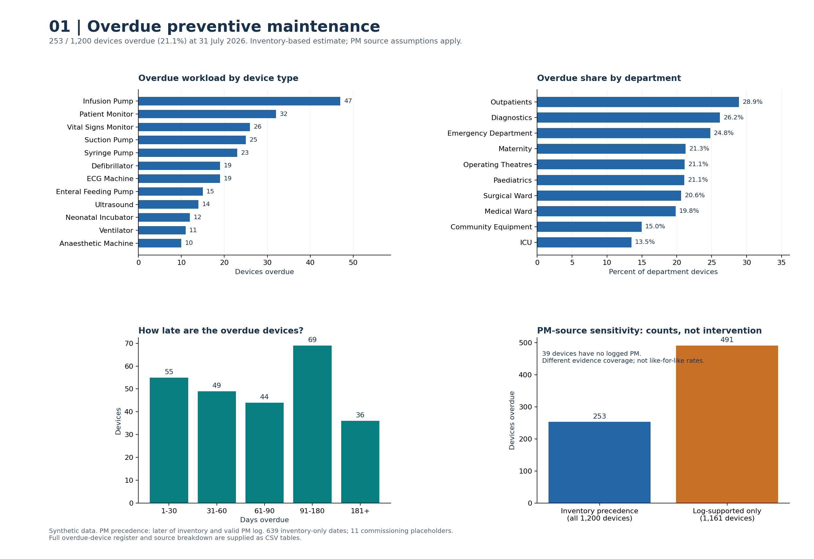
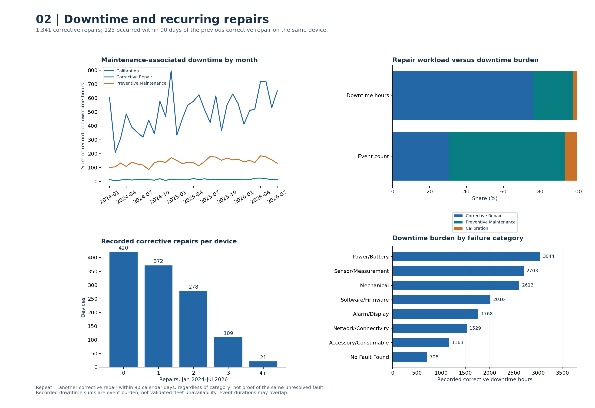

# MedSafe-R
### Medical Device Reliability & Patient Safety Intelligence

MedSafe-R is a portfolio prototype in development under **VictoryHealth Analytics**. It explores how medical-device data can support maintenance prioritisation, equipment reliability and patient safety.

The project brings together my interests in **Clinical Engineering, Healthcare Data Analytics and explainable AI**.

## Project Aim

To help answer:

**Which medical devices need engineering attention, why, and how urgently?**

The planned prototype will connect asset information, maintenance history, operational data and safety events to support transparent engineering decisions.

## Completed Work

**Synthetic Dataset v1** has been created, containing:

| Data component | Records |
|---|---:|
| Medical devices | 1,200 |
| Maintenance events | 4,751 |
| Monthly operational records | 7,200 |
| Safety events | 238 |
| Fictional regulatory signals | 18 |
| Machine-learning feature rows | 1,200 |

The workbook also includes an Excel overview dashboard and an initial heuristic engineering-priority score.

## Work in Progress

- Power BI dashboard for device reliability, maintenance and patient-safety indicators.
- Documentation of the dataset, relationships and analytical methods.

## Planned Development

1. Document and evaluate a transparent device-risk prioritisation approach.
2. Build and evaluate a predictive-maintenance baseline.
3. Add explanations showing what drives model predictions.
4. Explore safety-signal detection and model monitoring.

## Intended Tools

- **Power BI:** interactive dashboards.
- **Python:** data preparation, analysis and machine learning.
- **SQL:** data querying and reliability analysis.

Implementation details and results will be added as each stage is completed.

## Data and Limitations

Dataset v1 is **100% synthetic**. It contains no real patient, hospital, manufacturer, incident or regulatory data.

Future-event labels are simulated outcomes for model development; they do not demonstrate that a predictive model has been trained. The existing priority score is a heuristic and has not been clinically validated.

This project is for portfolio development and learning. It is not intended for real clinical, regulatory or maintenance decisions.

## Analysis Results — Corrected Dataset v1.3

The completed exploratory analysis covers:

- Overdue preventive maintenance.
- Downtime and recurring corrective repairs.
- Maintenance needs across device types and departments.
- Associations between reliability indicators and simulated safety events.
- Predictive-maintenance baseline models.

### Key Findings

- **253 of 1,200 devices (21.1%)** have overdue preventive maintenance, using the documented inventory-date assumptions.
- Corrective repairs account for **76.3%** of recorded maintenance downtime.
- **223 simulated safety events** affect **206 distinct devices**.
- Failure-label ROC AUC is approximately **0.68 for random forest**, compared with **0.70 for the engineering heuristic**.

These results describe synthetic data. They do not establish real-world predictive performance or patient-safety benefits.

### Chart Preview

### Reports and Supporting Files

- [Download the chart report](MedSafe_R_Chart_Report.pdf)
- [Download the offline HTML report](MedSafe_R_Analysis.html)
- [View all chart sets](charts/)
- [View supporting tables](tables/)
- [View the Python analysis](analysis.py)
- [View the corrected dataset](data/MedSafe_R_Dataset_v1.3_cleaned.xlsx)

Download the HTML file and open it in a browser to view the report.

### Reproduce the Analysis

Requires Python 3.11 or later.

    python -m pip install -r requirements.txt
    python analysis.py

The script reads the corrected workbook from `data/` and regenerates
the charts, tables, reports and model evaluations.

### Validation Status

Data checks and internal cross-validation are completed.
External, prospective and real-world validation remain future work.

## Author

**Victoria Ekweani — VictoryHealth Analytics**

[View my portfolio](https://github.com/VictoriaE-ai/VictoryHealth-Analytics)
